# Java八股

`更新时间：2026-10-19`

注释解释：

- `<>`必填项，必须在当前位置填写相应数据

- `{}`必选项，必须在当前位置选择一个给出的选项

- `[]`可选项，可以选择填写或忽略

*注：该笔记内的可选项和参数均不完整，如有需要，请查询相关手册*

---

## 二分查找

二分查找是一种在有序数组中高效查找目标元素的方法，其核心思想是每次将查找范围对半分，通过比较中间元素与目标值的大小，排除一半不可能的区间，从而将问题规模不断缩小。二分查找可以将查询的时间复杂度由O(n)降低为O(logn)

- 定义一个已经排序的数组 A
- 定义左边界L，有边界R，确定搜索范围，循环执行二分查找
- 对于每一次查找，获取中间索引 M = Floor ((L+R) / 2)
- 中间索引的值 A[M] 与待搜索的值 T进行比较，有如下三种情况
  - A[M] == T 表示找到，返回中间索引
  - A[M] > T，中间值右侧元素都大于T，无需比较，中间索引左移，M - 1设置为右边界，重新查找
  - A[M] < T，中间值左侧元素都小于T，无需比较，中间索引右移，M + 1设置为左边界，重新查找

- 当 L > R 时，表示没有找到，应结束循环

```java
public static int binarySearch(int[] arr, int target) {
    // 判断数组长度
    int length = arr.length;
    if (length < 1)
        return -1;
    else if (length == 1) {
        return target == arr[0] ? 0 : -1;
    }
    // 声明左右边界
    int l = 0, r = length - 1;
    // 声明中间索引
    int m;
    // 进入查找循环
    while (l <= r) {
        // 设置中间索引
        m = (l + r) / 2;
        // 比较arr[m]与target的值
        if (arr[m] == target)
            // 如果等于，直接返回索引
            return m;
        else if (arr[m] > target)
            // 如果大于，则右侧元素均大于，无需比较
            // 设置新的右边界
            r = m - 1;
        else
            // 如果小于，则左侧元素均大于，无需比较
            // 设置新的左边界
            l = m + 1;
    }
    return -1;
}
```

### 整数溢出

当左右边界都非常大，合计超过int的最大值时，现有方法在计算中间索引m时就会发生整数溢出问题。举个例子，假设现在有一个数组，长度为Integer.MAX_VALUE，那么r此时为Integer.MAX_VALUE - 1，需要查询的元素在数组右半侧，所以左边界右移，移动到 Integer.MAX_VALUE / 2 + 1的位置，此时再计算中间索引 m = Integer.MAX_VALUE / 2 + 1 + Integer.MAX_VALUE - 1，结果一定会大于Integer.MAX_VALUE，造成整数溢出

```java
public static void main(String[] args) {
    int l = Integer.MAX_VALUE / 2 + 1, r = Integer.MAX_VALUE - 1;
    int m = (l + r) / 2;
    System.out.println("new m is " + m);
}
```

> 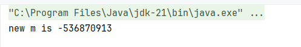

**方案一**

解决方案有多种，例如从计算方式入手，造成整数溢出的原因是左边界和右边界之和超过了int最大值，那么我们在计算m时可以不直接使用加号
$$
\frac{l+r}{2} \Rightarrow \frac{l}{2} + \frac{r}{2} \Rightarrow l - \frac{l}{2} + \frac{r}{2} \Rightarrow l + (\frac{r}{2} - \frac{l}{2}) \Rightarrow l + \frac{r-l}{2}
$$
由于r通常比较大，我们让r先减去l，然后再除以2，最后再加上l，l又比较小，所以就可以避免整数溢出的问题

**方案二**

如果我们仅从int8字节的角度来看，l + r大于8字节时就会认为是整数溢出，但如果从更高位角度来看，假设他没有发生溢出，我们正常进行除以2的运算。不过这里并不是直接将其更换为long类型，而是换用按位右移运算符，在位运算中，只考虑整数除法的情况下，按位右移与除以2完全相等，即使发生了整数溢出，在按位右移后，符号位一定会补0，也就是回到整数范围内，这样就可以巧妙地解决整数溢出的问题，而且cpu对于按位运算的性能更好，java底层的二分查找就使用了按位右移

```java
// Like public version, but without range checks.
private static int binarySearch0(int[] a, int fromIndex, int toIndex,
                                 int key) {
    int low = fromIndex;
    int high = toIndex - 1;

    while (low <= high) {
        int mid = (low + high) >>> 1;
        int midVal = a[mid];

        if (midVal < key)
            low = mid + 1;
        else if (midVal > key)
            high = mid - 1;
        else
            return mid; // key found
    }
    return -(low + 1);  // key not found.
}
```

在Java中，按位右移有两种，有符号按位右移`>>`和无符号按位右移`>>>`，这里应使用无符号按位右移，因为我们需要右移后数字回到整数范围，高位补0，在溢出的情况下，高位始终为1，如果使用有符号按位右移会导致右移后高位补1，溢出持续存在

### 面试真题：二分查找

1. 有一个有序表为1,5,8,11,19,22,31,35,40,45,48,49,50，当二分查找值为48的节点时，查找成功需要比较的次数为？

使用标准的二分查找逻辑在做题时效率较低，所以我们利用一些简单规则，即当数组为偶数时，中间值为中间两个值靠左侧的一个；当数组为奇数时，直接找中间的一个元素即可

例如该题中数组长度为13，则中间值为31,31左右两侧各有6个元素，不需要考虑索引。然后在左边界移动到35，35到50之间共有6个元素，中间值有45和48两个，靠左侧的一个即是45。左边界继续右移，48到50之间有三个元素，中间值取49。右边界左移，最后剩下48，找到元素，共计4次查找

2. 使用二分法在序列 1,4,6,7,15,33,39,50,64,78,75,81,89,96中查找元素81时，需要经过多少次比较？

与上一题相同，使用简单规则快捷计算次数，数组长度为14，中间值为39和50，取39；左边界右移，从50到96长度为7，中间值为75，左边界右移；从81到96仅剩下三个元素，直接快速确定最后剩下两次查找，所以共计也是4次查找

3. 在已知的128个数组中二分查找一个数，需要比较的次数最多不超过多少次？

其实是很基本的数学题目，二分查找的本质是循环除以二，所以实际是求2的几次幂为128，按照纯数学方案也就是求以二为底，128的对数 $\log_{2}{128}$。如果数字比较小，可以直接口算，2的幂分别为2、4、8、16、32、64、128、256、512、1024等等，这样也可以方便计算出结果为7。如果数组长度非常大，则只能用对数的方式，如果只能计算以十为底的对数，则计算公式为 $\frac{\lg{128}}{\lg{2}}$，假设数组长度为40亿，求需要比较的次数最多不超过多少次

> 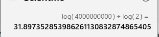

向上取整为32，如果结果是整数则直接作为结果

## 排序算法

### 冒泡排序

冒泡排序的核心思想是对比相邻两个元素的大小，如果左侧元素比右侧大，则应该交换元素位置，然后指针右移，以此类推，在重复多次后，实现全部元素排序的效果。举个例子，假设有一个数组3,2,1，现在进行冒泡排序，需要遵循以下步骤

- 进行第一轮排序，从索引0开始，取3和2两个元素
- 将两个元素进行比较，3比2大，所以3与2交换位置，得到新数组2,3,1
- 指针右移到索引1，取当前位置和右侧位置的元素，得到3和1
- 将两个元素进行比较，3比1大，所以3与1交换位置，得到新数组2,1,3
- 第一次排序完成，进行第二轮排序，指针回到索引0，取得2和1
- 比较两个元素大小，2比1大，交换元素位置，得到新数组1,2,3
- 指针右移到索引1，取得2和3
- 比较两个元素大小，2比3小，所以不需要交换位置
- 第二轮排序完成，所有元素都已经排序到了正确的位置，所以可以终止排序

从冒泡排序的步骤中不难看出，假设数组长度为n，排序的最大次数不超过n - 1，每次排序时，遍历的数组元素个数也不能超过n - 1，否则会造成指针越界

```java
// 冒泡排序
public static void bubbleSort(int[] arr) {
    int len = arr.length, tmp;
    for (int j = 0; j < len - 1; j++) {
        for (int i = 0; i < len - 1; i++) {
            if (arr[i] > arr[i + 1]) {
                tmp = arr[i];
                arr[i] = arr[i + 1];
                arr[i + 1] = tmp;
            }
        }
    }
}
```

**优化：减少比较次数**

冒泡排序有一个显著的特征，因为是相邻元素比较，每一次遍历一定能将一个元素移动到右侧的正确位置，所以每新一轮的比较中，可以依次减小一次比较次数。举个例子，无论数组的最大元素在哪个位置，如2,4,5,1,3、5,2,1,3,4，在第一次遍历中，5一定能移动到最右侧，如下

```sort
// 2,4,5,1,3第一次遍历
[2,4],5,1,3 --不交换-> 2,[4,5],1,3 --不交换-> 2,4,[5,1],3 --交换-> 2,4,1,[5,3] --交换-> 2,4,1,3,5

// 5,2,1,3,4第一次遍历
[5,2],1,3,4 --交换-> 2,[5,1],3,4 --交换-> 2,1,[5,3],4 --交换-> 2,1,3,[5,4] --交换-> 2,1,3,4,5
```

所以我们对代码进行一些优化，在比较大小的循环中，每次循环的次数减去当前排序的轮数减一，每一轮循环一定可以确定一个元素的位置

```c
// 冒泡排序
public static void bubbleSort(int[] arr) {
    int len = arr.length, tmp;
    for (int j = 0; j < len - 1; j++) {
        for (int i = 0; i < len - 1 - j; i++) {
            if (arr[i] > arr[i + 1]) {
                tmp = arr[i];
                arr[i] = arr[i + 1];
                arr[i + 1] = tmp;
            }
        }
    }
}
```

**优化：减少冒泡次数**

在冒泡排序中不难发现，即使数组已经完成了排序，算法仍会继续进行遍历，直到len - 1，如下为数组1,2,3,4,5进行冒泡排序

> 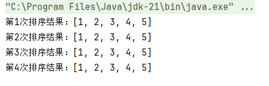

所以当一个数组完成排序后，就不需要再进行排序了，那么如何知道一个数组完成了排序呢？在冒泡排序中，对于没有完成排序的数组，一定会发生元素位置的交换，所以，只要确定数组中没有发生元素位置的交换，也就可以认为数组完成了排序

声明一个新的变量boolean swapped，用于标记本次排序中是否发生了元素位置交换，如果有，则赋值为true，然后在每轮排序后检查swapped的值，只要为false，就可以认为数组排序已经完成了，不需要下一轮排序

```java
// 冒泡排序
public static void bubbleSort(int[] arr) {
    int len = arr.length, tmp;
    boolean swapped;
    for (int j = 0; j < len - 1; j++) {
        swapped = false;
        for (int i = 0; i < len - 1 - j; i++) {
            if (arr[i] > arr[i + 1]) {
                tmp = arr[i];
                arr[i] = arr[i + 1];
                arr[i + 1] = tmp;
                swapped = true;
            }
        }
        if (!swapped) break;
    }
}
```

> 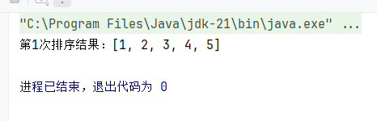

**优化：最佳实现**

假设存在一个特殊的数组2,4,1,3,5,7,8,9，按照上文的比较次数优化算法，第一轮需要比较7次，第二轮需要比较6次。但实际上，这个数组右侧的元素已经完成了排序，第二轮仅需比较2次就可以了，所以比较次数还可以进一步优化

> 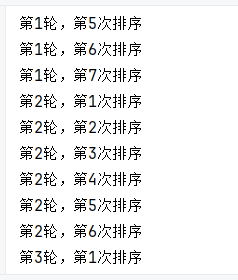

优化比较次数的最终方案与上文减少冒泡次数相似，我们需要得知右侧的元素是否已经完成了排序，也就是右侧的元素位置是否发生了交换。如果我们记录每轮排序时最后一个交换位置的索引，那么该索引右侧的元素就可以认为已经完成了排序——因为没有发生位置交换，在下一轮排序中，就可以直接排除该索引右侧的元素

我们定义两个额外的变量lastSwappedIndex和currentSwappedIndex，lastSwappedIndex记录最后一次交换位置的索引，currentSwappedIndex记录当前排序循环中交换位置的元素索引，在每一轮排序后，将currentSwappedIndex赋值给lastSwappedIndex，循环遍历的右边界改为lastSwappedIndex，就可以缩短每次遍历的次数。而且currentSwappedIndex本身也可以判断数组是否发生了位置交换，如果我们让currentSwappedIndex默认为0，只要没有发生交换，currentSwappedIndex = 0恒为0

```java
// 冒泡排序
public static void bubbleSort(int[] arr) {
    int len = arr.length, tmp, lastSwappedIndex = len - 1;
    do {
        int currentSwappedIndex = 0;
        for (int i = 0; i < lastSwappedIndex; i++) {
            if (arr[i] > arr[i + 1]) {
                tmp = arr[i];
                arr[i] = arr[i + 1];
                arr[i + 1] = tmp;
                currentSwappedIndex = i;
            }
        }
        lastSwappedIndex = currentSwappedIndex;
    } while (lastSwappedIndex != 0);
}
```

> 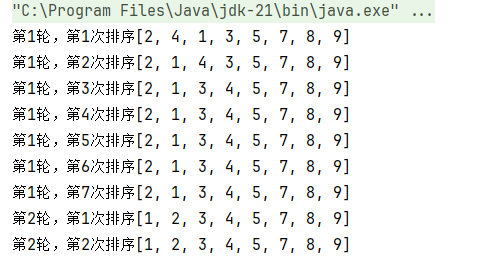

### 选择排序

选择排序是每次遍历中选取当前最小的元素置于最左侧，每轮确定一个元素位置，然后左边界右移，以此类推，达到最终排序的目的。举个例子，存在一个数组3,1,2，进行选择排序遵循以下步骤

- 进行第一轮排序，选择左侧第一个元素3，暂定为当前最小元素
- 然后指针右移，比较当前元素与当前最小元素，1比3小，所以当前最小元素更改为1
- 指针继续右移，比较当前元素与当前最小元素，2比1大，所以当前最小元素不变
- 第一轮排序结束，将当前最小元素移动到数组中索引为0的位置，左边界右移，得到数组1,3,2
- 进行第二轮排序，选择左侧第一个元素3，暂定为当前最小元素
- 指针右移，比较当前元素与当前最小元素，2比3小，所以当前最小元素为2
- 第二轮排序结束，当当前最小元素移动到数组中索引为1的位置，得到数组1,2,3，完成排序

所以，在选择排序中，如果存在一个数组，长度为n，需要排序的最大轮数是n - 1，每轮中需要遍历的次数最多为n - 1

```java
// 选择排序
public static void selectionSort(int[] a) {
    for (int i = 0; i < a.length - 1; i++) {
        int s = i;
        for (int j = s + 1; j < a.length; j++) {
            if (a[s] > a[j]) s = j;
        }
        if (s != i) {
            int tmp = a[i];
            a[i] = a[s];
            a[s] = tmp;
        }
    }
}
```

上文编写的选择排序其实已经是优化后的版本，即在每轮遍历元素时，仅将最小元素的索引进行记录，然后在每轮遍历元素之后进行修改，而不是每次遇到最小元素，直接进行修改，这样可以减少元素交换次数

与冒泡排序相比，二者的时间复杂度都是O($n^2$)，选择排序一般比冒泡排序更快，因为交换次数更少；但如果集合的有序度高，冒泡会优于选择；冒泡排序属于稳定排序算法，选择排序不属于稳定排序算法

**双向选择排序**

选择排序的特点是每次记录最小值，然后交换最小值的位置，并右移左边界。为了提高排序效率，是否可以在每轮遍历中同时记录最大值，并左移右边界呢？这就是双向选择排序。双向选择排序同时维护最小值和最大值两个极值，每轮遍历中记录两个极值的位置，然后在遍历后同时进行修改，并同时缩小左右边界，形成一种“夹逼”的结构，当左边界大于或者等于右边界时，即认为排序完成

不过双向选择排序需要考虑一种特殊情况，当数组中最小值和最大值刚好位于两端时，如果最小值在右，最大值在左，那么不管在交换最小值还是最大值的时候，都会将另一个值的位置改变，所以此时需要先交换最小值与最大值，确保在最小值和最大值交换后，另一个值不会再次交换

```java
// 选择排序
public static void selectionSort_v2(int[] arr) {
    int len = arr.length, l = 0, tmp, r = len - 1;
    while (l < r) {
        int minIdx = l, maxIdx = r;
        for (int j = l; j <= r; j++) {
            if (arr[j] < arr[minIdx]) minIdx = j;
            if (arr[j] > arr[maxIdx]) maxIdx = j;
        }
        // 交换最大值
        tmp = arr[r];
        arr[r] = arr[maxIdx];
        arr[maxIdx] = tmp;

        if (minIdx == r) minIdx = maxIdx;

        // 交换最小值
        tmp = arr[l];
        arr[l] = arr[minIdx];
        arr[minIdx] = tmp;

        l++;
        r--;
    }
}
```

在上文的实现中，定义默认的左边界为索引0，右边界为最后一个元素索引len - 1，然后每轮遍历中，int minIdx = l, maxIdx = r暂定每轮的最小值和最大值均为左右边界，接着遍历目前边界中的所有元素，并确定两个极值的索引。然后先交换最大值，并判断最小值是否是右边界，如果是，则将最大值与最小值交换，此时再交换最小值，也就是实际的最大值原来的位置，即左边界，然后交换最小值，保证最小值与自己进行交换，位置不变

双向选择排序可以一定程度上减少选择排序遍历的次数，例如对数组`{1, 70, 12, 24, 49, 13, 20, 86, 56, 99, 38, 81, 92, 84, 60, 66, 64, 76, 29, 65}`进行排序

> 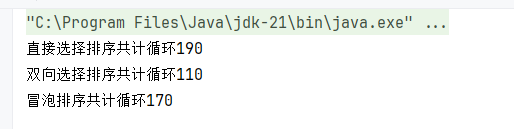

但如果是有序数组`{1, 10, 11, 13, 14, 19, 22, 36, 38, 39, 43, 53, 54, 56, 59, 65, 77, 78, 81, 94}`，排序效率远不如冒泡排序

> 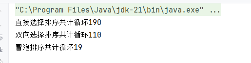

### 插入排序

插入排序的核心思想是扩大有序区域，对于一个乱序数组，我们暂确定左侧第一个元素是有序的，然后扩大有序区域，认为左侧两个元素应该是有序的，所以取出第二个元素，与第一个元素进行比较，如果第一个元素大于第二个元素，则将第一个元素右移，并在第一个元素的位置插入第二个元素。同理，有序区域继续扩大至第三个元素，然后取出第三个元素与前两个元素进行比较，再右移元素，并插入元素，以此类推，直到有序区域覆盖整个数组

插入排序效率略优于选择排序，但是是一种稳定排序算法，对于有序数组也不会产生多次排序。如果存在一个数组长度为n，插入排序的轮数不超过n - 1，因为从第二个元素开始，每轮遍历的元素从1开始累增，直到n - 1

```java
public static void insertSort(int[] arr) {
    for (int i = 1; i < arr.length; i++) {
        int insert = arr[i];
        for (int j = i - 1; j >= 0; j--) {
            if (arr[j] > insert) arr[j + 1] = arr[j];
            else {
                arr[j + 1] = insert;
                break;
            }
        }
    }
}
```

i表示左边界，同时也表示每轮排序中取出的待插入的元素，然后我们用一个新变量来临时存放这个元素，需要为其他元素移动预留空间。然后遍历边界外，也就是已经排序好的区域中的所有元素，从右向左比较，如果元素大于待插入的元素，则将元素右移，直到遇到第一个小于待插入元素的元素。因为遍历的的数组是已经排序的数组，所以当第一个小于元素出现时，一定可以确定前面的所有元素都会小于待插入元素，然后将待插入元素插入到指针所指向的元素后面一个位置

### 希尔排序

希尔排序是对插入排序进行的一种改进，如果数组中比较大的元素都在数组左侧，那么在进行普通插入排序时就会造成很多元素位置的移动。而希尔排序的核心思想是先将大的数字尽可能快地右移，这样就可以减少总体元素移动次数

希尔排序将一个数组按间隙分成了多个不同的子数组，间隙是指元素之间间隔的元素个数，假设存在数组6,5,4,3,2,1，按照间隙3划分，可以分为3个子数组，6,3、5,2，4,1，然后对每个子数组进行插入排序，得到3,2,1,6,5,4，接着缩小间隙为2，得到2个子数组，3,1,5、2,6,4，再分别对这两个子数组进行插入排序，得到1,2,3,4,5，再缩小间隙为1，再进行一次插入排序，最终完成排序

间隙的选择是希尔排序效率的核心因素，直接影响算法的时间复杂度

> 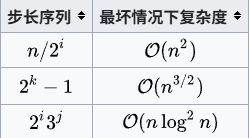

### 面试真题：第n轮排序的结果

1. 如果使用直接插入排序算法和直接选择排序算法对序列18,23,19,9,23,15进行排序，第三轮排序后的结果分别为？

先来看插入排序，我们知道插入排序的特点是从索引1开始，从左向右取出每一个元素，然后将元素与已经排序的元素进行比较。所以插入排序的特征是将数组分为两部分，前半部分为已经排序部分，后半部分为未排序部分，且未排序部分元素顺序永远不变。据此我们可以来推导下排序过程

```insertSort
[18],23,19,9,23,15 -> [18,23],19,9,23,15 -> [18,19,23],9,23,15 -> [9,18,19,23],23,15 -> ...
```

所以第三轮排序后结果为9,18,19,23,23,15。插入排序的快捷计算方式是依次取出数组中每一个元素加入新数组，第n轮就输出原数组前n个数字的有序数组

然后是选择排序，选择排序的特点是从0开始每轮选择第一个元素为最小元素，然后将数组中最小元素与第一个元素交换位置，并右移左边界。因此选择排序的未排序数组顺序会发生改变，只能通过推导得出结果

```selectionSort
[18,23,19,9,23,15] -> 9,[23,19,18,23,15] -> 9,15,[19,18,23,23] -> 9,15,18,[19,23,23] -> ...
```

所以第三轮排序后结果为9,15,18,19,23,23。选择排序的快捷计算方式是依次取出原数组中最小的元素加入新数组，第n轮就输出最终排序好的数组的前n个数字

### 快速排序

快速排序有些类似于二分查找，在数组中选择一个元素为基准，然后将比该元素小的放在左边，比该元素大的放在右边，这样就可以确定该元素的位置。接着继续在左右两侧各选择一个元素继续分区，以此类推，直到分区小于等于1

#### 单边循环

在单边循环中，基准点一般选择最右侧元素，定义两个指针，j指针负责找到比基准点小的元素，一旦找到则与i进行交换。i指针维护小于基准点元素的边界，也就是每次交换的目标索引。最后基准点与i交换，i即为分区位置

这样描述比较复杂，我们举一个例子，假设存在一个数组5,3,7,2,9,8,1,4

- 指针i，j起始位置均为最左侧元素5，基准点为最右侧元素4
- 然后指针j右移，一旦遇到比基准点小的元素，就与i交换，并右移i
- j右移到3，比较得知3比基准点4小，所以j与i互换，i右移，得到数组3,5,7,2,9,8,1,4
- 此时i，j均指向5，然后j继续右移
- j右移到2，2比基准点4小，所以i与j交换位置，i右移，得到数组3,2,7,5,9,8,1,4
- 以此类推，得到数组3,2,1,5,9,8,7,4
- 然后基准点与i进行交换，因为此时可以确定i右侧元素都是大于基准点的元素，得到数组3,2,1,4,9,8,7,5

以上的步骤被称为分区，快速排序实际就是在分区的基础上继续进行分区， 我们先来编写一个分区方法

```java
private static int partition(int[] arr, int left, int right) {
    // 确定基准元素
    int pivot = arr[right];
    // 确定i,j
    int i = left;
    for (int j = left; j < right; j++) {
        if (arr[j] < pivot) {
            swap(arr, i, j);
            i++;
        }
    }
    // 交换i和基准
    swap(arr, i, right);
    return i;
}
```

> 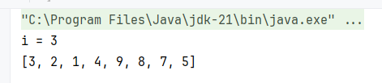

然后根据返回的位置，就可以将数组分为左右两个部分，继续进行快速排序，让区间越来越小，直到区间范围为1，就可以认为数组全部有序，这里可以递归实现

```java
public static void quickSort(int[] arr, int left, int right) {
    if (left >= right) return;
    // 获取基准索引
    int pivot = partition(arr, left, right);
    // 根据返回的索引，数组分为两个区间，对每一个区间执行一次快速排序
    quickSort(arr, left, pivot - 1);
    quickSort(arr, pivot + 1, right);
}
```

对每一次新的排序，由partition获取新的基准索引，并根据索引分区，递归进行排序。对于左半部分，其左边界为原来的左边界，右边界为基准位置的左边一个位置，也就是pivot - 1；对于右半部分，左边界为基准位置右边的一个位置，也就是pivot + 1，右边界为原来的右边界。而递归的出口则是当左边界大于等于右边界的时候，如果左边界等于右边界，则表示当前区间范围为1，已经完成了排序。如果左边界大于右边界，则是因为左边界越界或者右边界越界，例如当基准位置为0时，此时左侧就没有分区了，计算pivot - 1得到-1，数组越界；或者当基准位置为数组最后一个元素，假设数组长度为6，当基准位置为5时，计算pivot + 1得到6，数组越界，直接返回，表示该方向已经排序完成

> 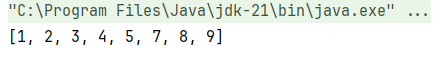

#### 双边循环

在单边循环中，选择最左侧元素为基准点元素，j指针负责从右向左找比基准点小的元素，i指针负责从左向右找比基准点大的元素，一旦找到二者进行交换，直至i等于j，最后基准点与i交换，i积分分区位置

同样举个例子，假设存在一个数组5,3,7,2,9,8,1,4

- 选择最左侧元素5为基准点，i此时为5，j此时位于数组最右侧，位于4的位置
- 开始进行比较，j此时发现4小于基准点，因此停止等待
- 然后i右移，寻找比基准点大的元素，移动到7的位置
- 交换i，j，得到新数组5,3,4,2,9,8,1,7
- 然后j左移到1，比基准点小，停止等待
- i右移到9，与j进行交换，得到新数组5,3,4,2,1,8,9,7
- j左移到8的位置，i右移到8的位置，此时j等于i，停止循环
- 比较当前元素与基准点元素的大小，如果大于，基准点元素与当前元素索引 - 1 进行交换，否则交换当前元素
- 基准点与1进行交换，一轮排序完成，得到新数组1,3,4,2,5,8,9,7

```java
private static int partition_v2(int[] arr, int left, int right) {
    // 确定基准元素
    int pivot = arr[left];
    // 确定i, j
    int i = left + 1, j = right;
    while (i < j) {
        if (arr[i] > pivot && arr[j] < pivot) {
            swap(arr, i, j);
            i++;
            j--;
        }
        if (arr[i] <= pivot) i++;
        if (arr[j] >= pivot) j--;
    }
    if (arr[i] > pivot) {
        swap(arr, i - 1, left);
        return i - 1;
    }
    swap(arr, i, left);
    return i;
}
```

> 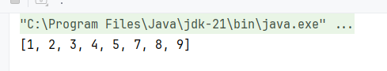

快速排序平均时间复杂度为$O(n \times \log_2n)$，最坏时间复杂度为$O(n^2)$，数据量越大，优势越明显。快速排序有多种实现方式，均属于不稳定排序。一般认为，双边循环快排比单边循环快3倍左右

## 集合

### ArrayList扩容

使用ArrayList的无参构造器默认创建的是一个长度为0的数组

```java
private static final Object[] DEFAULTCAPACITY_EMPTY_ELEMENTDATA = {};

public ArrayList() {
    this.elementData = DEFAULTCAPACITY_EMPTY_ELEMENTDATA;
}
```

对于有参构造器，如果传入的是数组长度，则返回一个指定长度数组

```java
public ArrayList(int initialCapacity) {
    if (initialCapacity > 0) {
        this.elementData = new Object[initialCapacity];
    } else if (initialCapacity == 0) {
        this.elementData = EMPTY_ELEMENTDATA;
    } else {
        throw new IllegalArgumentException("Illegal Capacity: "+
                                           initialCapacity);
    }
}
```

如果传入一个集合，则按照集合的大小来创建数组

```java
public ArrayList(Collection<? extends E> c) {
    Object[] a = c.toArray();
    if ((size = a.length) != 0) {
        if (c.getClass() == ArrayList.class) {
            elementData = a;
        } else {
            elementData = Arrays.copyOf(a, size, Object[].class);
        }
    } else {
        // replace with empty array.
        elementData = EMPTY_ELEMENTDATA;
    }
}
```

#### add扩容

向ArrayList中插入第一个数据时，就会触发其扩容机制

```java
public boolean add(E e) {
    modCount++;
    add(e, elementData, size);
    return true;
}
```

modCount是结构性修改计数器，与下文的快速失败机制有关。然后执行了add(e, elementData, size)

```java
private void add(E e, Object[] elementData, int s) {
    if (s == elementData.length)
        elementData = grow();
    elementData[s] = e;
    size = s + 1;
}
```

size用于记录ArrayList中保存的元素的个数，也就是ArrayList的实际大小。然后判断实际大小是否等于数组的最大长度，如果等于，则说明数组已经满了，需要扩容。对于新数组，elementData.length为0，size也为0，所以执行elementData = grow()

```java
private Object[] grow() {
    return grow(size + 1);
}
```

调用了重写方法，并传入参数size + 1

```java
private Object[] grow(int minCapacity) {
    int oldCapacity = elementData.length;
    if (oldCapacity > 0 || elementData != DEFAULTCAPACITY_EMPTY_ELEMENTDATA) {
        int newCapacity = ArraysSupport.newLength(oldCapacity,
                minCapacity - oldCapacity, /* minimum growth */
                oldCapacity >> 1           /* preferred growth */);
        return elementData = Arrays.copyOf(elementData, newCapacity);
    } else {
        return elementData = new Object[Math.max(DEFAULT_CAPACITY, minCapacity)];
    }
}
```

通过int oldCapacity = elementData.length获取原来的数组长度，然后判断数组长度是否大于0，如果大于0，则执行ArraysSupport.newLength扩容，如果是新数组，长度为0，则初始化一个新数组，长度为DEFAULT_CAPACITY和minCapacity中的最大值。minCapacity是传入的size + 1，我们知道size为0，所以minCapacity也就为1

```java
private static final int DEFAULT_CAPACITY = 10
```

DEFAULT_CAPACITY默认为10，所以对于新创建的ArrayList，在第一次插入数据时，其容量会被扩展到10

```java
public static int newLength(int oldLength, int minGrowth, int prefGrowth) {
    // preconditions not checked because of inlining
    // assert oldLength >= 0
    // assert minGrowth > 0

    int prefLength = oldLength + Math.max(minGrowth, prefGrowth); // might overflow
    if (0 < prefLength && prefLength <= SOFT_MAX_ARRAY_LENGTH) {
        return prefLength;
    } else {
        // put code cold in a separate method
        return hugeLength(oldLength, minGrowth);
    }
}
```

newLength是ArraysSupport中一个用于计算合适的数组长度的方法，传入三个参数oldLength旧数组长度、minGrowth最小增量、prefGrowth推荐增量。在ArrayList的扩容中，minGrowth为minCapacity - oldCapacity，oldCapacity为elementData.length，而minCapacity 为size + 1，当size == elementData.length才触发扩容，所以minGrowth恒为1；prefGrowth默认为oldCapacity >> 1，oldCapacity是正数，所以oldCapacity >> 1等价于oldCapacity / 2，也就是原容量的一半

然后int prefLength = oldLength + Math.max(minGrowth, prefGrowth)计算合适的新容量，取minGrowth和prefGrowth的最大值，加上oldLength。我们知道minGrowth恒为1，所以prefLength一定为oldLength + oldLength / 2，也就是原容量的1.5倍

不过当prefGrowth非常大时，计算oldLength + Math.max(minGrowth, prefGrowth)可能导致溢出，所以为了安全，需要判断if (0 < prefLength && prefLength <= SOFT_MAX_ARRAY_LENGTH)，当prefLength大于0且长度不超过SOFT_MAX_ARRAY_LENGTH，也就是2147483639时，才返回prefLength，否则需要执行hugeLength(oldLength, minGrowth)

```java
private static int hugeLength(int oldLength, int minGrowth) {
    int minLength = oldLength + minGrowth;
    if (minLength < 0) { // overflow
        throw new OutOfMemoryError(
            "Required array length " + oldLength + " + " + minGrowth + " is too large");
    } else if (minLength <= SOFT_MAX_ARRAY_LENGTH) {
        return SOFT_MAX_ARRAY_LENGTH;
    } else {
        return minLength;
    }
}
```

对于大容量，无法扩展到自身1.5倍长度的数组，会计算oldLength + minGrowth得到能够使用的最小长度，然后判断是否溢出，如果溢出，则抛出OutOfMemoryError异常，如果小于SOFT_MAX_ARRAY_LENGTH，则直接扩容到SOFT_MAX_ARRAY_LENGTH，如果大于SOFT_MAX_ARRAY_LENGTH但没有溢出，则扩容到计算出的minLength。SOFT_MAX_ARRAY_LENGTH为Integer. MAX_VALUE - 8，所以理论上ArrayList的长度可以到Integer. MAX_VALUE。但是一般JVM不会允许直接创建这么大容量的数组

add扩容方式得到的数组长度可以形成一个特定列表

```java
0, 10, 15, 22, 33, 49, 73, 109, 163, 244, 366, 549, 823, 1234, 1851, 2776, 4164, 6246, 9369, 14053, 21079...
```

#### addAll扩容

addAll与add方法的扩容有些不同

```java
public boolean addAll(Collection<? extends E> c) {
    Object[] a = c.toArray();
    modCount++;
    int numNew = a.length;
    if (numNew == 0)
        return false;
    Object[] elementData;
    final int s;
    if (numNew > (elementData = this.elementData).length - (s = size))
        elementData = grow(s + numNew);
    System.arraycopy(a, 0, elementData, s, numNew);
    size = s + numNew;
    return true;
}
```

首先将传入的集合转换为数组，然后自增modCount，判断插入的集合长度是否为空，如果为空，则返回false。然后判断当前数组长度减去实际存储的容量是否大于需要插入的数组的长度，否则进行扩容，扩容大小为当前实际长度加上需要插入的数组长度

所以，对于一个空的ArrayList，如果执行addAll插入一个长度小于11的集合，那么会扩容为10；但如果插入一个长度大于11的集合，则会扩容为插入的集合长度，而不是add扩容方式对应的容量列表

但是，对于一个已经有数据的ArrayList，插入另一个集合时，其容量取决于二者的长度之和。如果长度和小于旧集合的下次扩容，则直接按add方式扩容；如果长度和大于下次扩容，则扩容到长度和

下面用示例来证明，向一个长度为10的ArrayList中插入长度为3的集合

```java
public static void main(String[] args) throws Exception {
    List<Object> list = new ArrayList<>(10);
    for (int i = 0; i < 10; i++) {
        list.add(i);
    }
    // 下次扩容时10 -> 15
    list.addAll(List.of(1, 2, 3));
    // 获取属性
    Field elementDataField = ArrayList.class.getDeclaredField("elementData");
    elementDataField.setAccessible(true);
    // 获取属性值
    Object[] elementData = (Object[]) elementDataField.get(list);
    System.out.println(elementData.length);
}
```

> 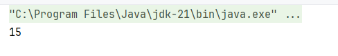

然后重新插入一个长度为6的集合

```java
public static void main(String[] args) throws Exception {
    List<Object> list = new ArrayList<>(10);
    for (int i = 0; i < 10; i++) {
        list.add(i);
    }
    // 下次扩容时10 -> 15
    list.addAll(List.of(1, 2, 3, 4, 5, 6));
    // 获取属性
    Field elementDataField = ArrayList.class.getDeclaredField("elementData");
    elementDataField.setAccessible(true);
    // 获取属性值
    Object[] elementData = (Object[]) elementDataField.get(list);
    System.out.println(elementData.length);
}
```

> 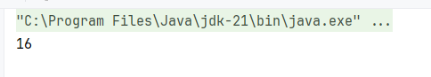

### fail_fast和fail_safe

fail_fast和fail_safe是集合迭代器Iterator的两种针对并发修改问题的应对措施。先来说说什么是并发修改，当迭代器遍历某个集合时，如果集合中元素增多或者元素减少，导致集合长度发生变化，此时迭代器指针所指向的元素也可能发生变化，如下

假设此时指针指向索引1，元素为2

```iterator
1, 2, 3, 4, 5
   ^
```

然后集合长度发生变化，在1和2之间插入了元素6

```iterator
1, 6, 2, 3, 4, 5
   ^
```

这就导致本来迭代器操作的元素是2，但是却变成了6，造成了数据不一致的情况

fail_fast快速失败，是指当并发修改发生时，立即终止遍历，并抛出并发修改异常。而fail_safe故障保护，当并发修改发生时，做出一些应对措施，允许临时的数据不一致，让遍历能够运行完成

ArrayList的迭代器属于fail_fast类型，不允许并发修改

```java
public static void main(String[] args) throws Exception {
    List<Object> list = new ArrayList<>(10);
    for (int i = 0; i < 10; i++) {
        list.add(i);
    }
    for (Object i : list) {
        list.add(2, 0);
    }
```

例如遍历list时，向索引为2的位置插入一个元素0

> 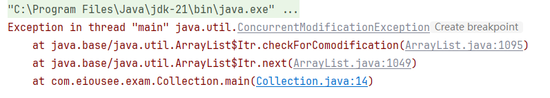

而java.util.concurrent.CopyOnWriteArrayList的迭代器则属于fail_safe类型，支持并发修改

```java
public static void main(String[] args) throws Exception {
    List<Object> list = new CopyOnWriteArrayList<>();
    for (int i = 0; i < 10; i++) {
        list.add(i);
    }
    for (Object i : list) {
        list.add(2, 0);
    }
    System.out.println(list);
}
```

> 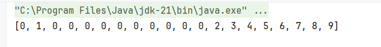

#### fail_fast

在执行增强for的时候，会先创建一个迭代器对象

```java
public Iterator<E> iterator() {
    return new Itr();
}
```

在创建迭代器时，会维护一个属性int expectedModCount = modCount，modCount在ArrayList中用于记录结构性修改操作时，modCount都会自增，上文也有所提及。结构性修改是指增加、删除、清空、替换等操作，而迭代器获取一份modCount，也就是为了确保在遍历过程中，能根据结构性修改次数来判断是否发生并发修改

```java
public E next() {
    checkForComodification();
    int i = cursor;
    if (i >= size)
        throw new NoSuchElementException();
    Object[] elementData = ArrayList.this.elementData;
    if (i >= elementData.length)
        throw new ConcurrentModificationException();
    cursor = i + 1;
    return (E) elementData[lastRet = i];
}
```

在执行迭代器的next方法时，就会先调用checkForComodification()检查modCount的值是否被修改，而且还会if (i >= elementData.length)判断指针是否越界，如果指针越界，也说明在遍历时有元素插入，抛出ConcurrentModificationException并发修改异常

```java
final void checkForComodification() {
    if (modCount != expectedModCount)
        throw new ConcurrentModificationException();
}
```

 #### fail_safe

在CopyOnWriteArrayList的迭代器初始化时，会保留一份原数组的备份es

```java
COWIterator(Object[] es, int initialCursor) {
    cursor = initialCursor;
    snapshot = es;
}
```

在迭代器进行遍历时，实际操作的元素始终是备份es，而不是原数组，所以即使在遍历时进行结构性修改，也不会影响正在遍历的数组

```java
public E next() {
    if (! hasNext())
        throw new NoSuchElementException();
    return (E) snapshot[cursor++];
}
```

我们来观察COW的add方法

```java
public boolean add(E e) {
    synchronized (lock) {
        Object[] es = getArray();
        int len = es.length;
        es = Arrays.copyOf(es, len + 1);
        es[len] = e;
        setArray(es);
        return true;
    }
}
```

上来就添加了一个互斥锁，锁的来源是final transient Object lock = new Object()，也就是每个实例都有一把不同的锁，保证一个实例在同一时间只能被一个线程访问。然后获取当前的数组，并获取长度，将当前数组扩容，并将元素插入，然后将扩容后的数组返回给COW实例

因此，在对COW进行迭代器遍历时，获取到的数据都是原数组的备份，但是结构性操作又是在真正的数组中进行的。所以当我们遍历整个列表并打印，并不会是输出我们新增的元素

```java
public static void main(String[] args) throws Exception {
    List<Object> list = new CopyOnWriteArrayList<>();
    for (int i = 0; i < 5; i++) {
        list.add(i);
    }
    for (Object i : list) {
        list.add(2, 5);
        System.out.println(i);
    }
    System.out.println(list);
}
```

> 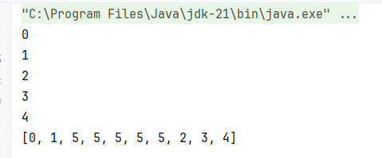

### LinkedList vs ArrayList

- ArrayList

1. 基于数组，需要连续内存
2. 随机访问快，可以根据下标访问
3. 尾部插入、删除性能更好，其他部分插入、删除都需要移动数据，性能相对较低
4. 可以利用cpu缓存，局部性原理

- LinkedList

1. 基于双向链表，无需连续内存
2. 随机访问慢，需要沿着链表遍历
3. 头尾插入与删除性能更好，因为仅需要改变节点头尾指针
4. 每个节点需要额外存储两个指针，占用内存相对更多

#### 随机访问性能对比

ArrayList基于数组结构，数组中存储的是指向各个元素的指针，而指针大小是确定的，所以只需要知道元素的索引，就可以快捷计算出元素距离数组头部的偏移量，然后得到数组的内存地址。ArrayList的查询时间复杂度为$O(1)$

LinkedList基于双向链表，由多个节点组成，每个节点有两个指针，分别指向上一个和下一个链表节点。如果需要查询链表的某个元素，则需要从头节点或者尾节点遍历，LinkedList的查询时间复杂度为$O(n)$

按照传统意义的查询来说，例如按照元素内容查询元素的下标，ArrayList和LinkedList的时间复杂度都是$O(n)$，如果需要快速查询，则应该选择如HashMap、TreeMap这样的结构

#### 增删性能对比

当需要向ArrayList中插入一个元素时，其时间复杂度会根据插入位置的不同而发生变化。当插入位置为尾部时，不需要移动元素，时间复杂度为$O(1)$；当插入位置为其他时，ArrayList需要将该位置后面的元素复制一份，然后右移一位覆盖原来的数组，再插入新数据，此时时间复杂度为$O(n)$。ArrayList的删除操作类似，删除尾部的时间复杂度为$O(1)$，其他位置为$O(n)$

而当需要向LinkedList插入数据时，其时间复杂度也根据插入位置的不同而不同。当插入位置为头部或者尾部时，仅需更改头部或者尾部元素的前指针和后指针，时间复杂度为$O(1)$；如果插入中间元素，则需要先遍历寻找位置，时间复杂度为$O(n)$。删除操作类似

ArrayList的中间增删操作性能仍优于LinkedList，因为ArrayList查询中间元素的性能更高

#### 局部性原理

在计算机中，CPU计算的速度非常快，CPU时钟周期是CPU中最小的时间单位，完成一个CPU命令一般需要一个或者更多的时钟周期。时钟周期是CPU主频率的倒数，对于现代主流桌面端CPU，主频一般在4G甚至5G赫兹以上，时钟周期也就是0.2纳秒左右。而CPU与内存间的读写性能一般在100纳秒左右，所以实际上CPU大量时间都是在等内存提供数据，而不是进行计算

而为了提高CPU的利用率，1985年起，英特尔首次为CPU添加独立的高速缓存，发展至今，形成了现在的CPU三级缓存L1、L2、L3。L1读写性能一般在1纳秒，L2在3到5纳秒，L3在10到20纳秒。如果三级缓存中仍无法获取数据，才从内存中获取数据

> 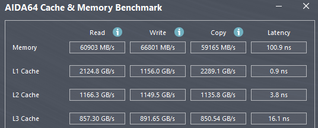

所以，如果想要提高计算机性能，就应该尽量提高CPU三级缓存的命中率，而局部性原理就是一种缓存优化措施。CPU在读取数组中元素到缓存时，并不会只读取需要计算的那一个特定元素，而是将数组中与之相邻的一些元素也读取到缓存中，因为相邻元素有很大可能也会被访问，这就是空间局部性

局部性原理将局部性分为三类

- 时间局部性：近期访问过的数据或指令很可能在不久后再次被访问，如循环中的变量
- 空间局部性：被访问位置附近的存储单元也可能很快被访问，如数组顺序遍历
- 顺序局部性：指令通常按顺序执行，顺序执行与非顺序执行比例约为 5:1

LinkedList因本身是非连续内存，在运算时不满足局部性原理，因此在缓存层面性能也比ArrayList更低

### HashMap

HashMap的底层数据结构在JDK1.7和1.8版本有所不同，1.7使用数组 + 链表结构，而1.8引入红黑树，使用数组 + 链表 + 红黑树结构。HashMap类似于Redis中的dict，在插入元素时先计算元素的哈希值，然后使用哈希值映射到数组上的一个位置，数组中存储的并不是一个一个的元素，而是一个单链表，如果哈希数组的长度足够小，就容易出现哈希碰撞，此时将新元素挂载在旧元素后方，就可以避免元素被覆盖或者无法插入

如下，我们定义一个长度为16的HashMap，向其中插入10个元素

> 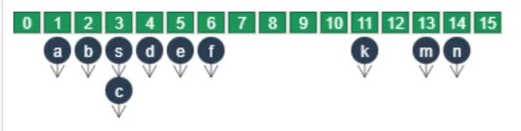

以下是有关HashMap的重要常量

```java
static final int DEFAULT_INITIAL_CAPACITY = 1 << 4; // aka 16
static final int MAXIMUM_CAPACITY = 1 << 30;
static final float DEFAULT_LOAD_FACTOR = 0.75f;
static final int TREEIFY_THRESHOLD = 8;
static final int MIN_TREEIFY_CAPACITY = 64;
static final int UNTREEIFY_THRESHOLD = 6;
```

- DEFAULT_INITIAL_CAPACITY：使用无参构造器时创建的桶数组的默认长度，每个桶就是一个节点链表
- MAXIMUM_CAPACITY：HashMap允许的最大容量
- DEFAULT_LOAD_FACTOR：默认负载因子，当负载率超过这个值时会触发扩容，负载率等于负载量除以总容量
- TREEIFY_THRESHOLD：长度树化阈值，当桶中的链表长度大于等于8时，会树化形成红黑树
- MIN_TREEIFY_CAPACITY：容量树化阈值，当桶数组的长度大于等于64时，才会触发树化，与TREEIFY_THRESHOLD必须同时满足
- UNTREEIFY_THRESHOLD：退化阈值，当红黑树节点树小于等于6时，会从红黑树退化为链表

```java
static class Node<K,V> implements Map.Entry<K,V> {
    final int hash;
    final K key;
    V value;
    Node<K,V> next;
}
```

这是HashMap中有关节点的定义，一个节点中存储了四个属性，分别是哈希值、键、值和指向下一个Node的指针

#### 链表过长问题

哈希表最大的优点是查询速度非常快，如果使用合适的哈希函数，并且数据量较小，HashMap的查询时间复杂度为$O(1)$，等同于数组；但是如果哈希函数选择不恰当，或者在小容量的哈希表中存储大量结构，导致一个桶存储了大长度的链表，HashMap的最坏时间复杂度会降低到$O(n)$，因为需要遍历链表中每一个元素

对于HashMap，提升查询性能实际就是缩短链表长度，或者提升链表的查询性能。目前有扩容和树化两种方案

##### 扩容

HashMap在插入时，先计算键的哈希值，然后以哈希值为基准，映射出桶数组上的一个索引位置，再在对应位置插入Entry。而如果对HashMap进行扩容，就可以使映射的范围更大，原来索引相同的元素在扩容后的索引就可能不同，从而减短链表长度，提升性能

HashMap的扩容永远只会发生在size大于threshold的时候，每次调用put()、putAll()等方法时，会判断当前的size与threshold的关系

```java
public V put(K key, V value) {
    return putVal(hash(key), key, value, false, true);
}
```

包装方法，实际调用了putVal()

```java
final V putVal(int hash, K key, V value, boolean onlyIfAbsent,
               boolean evict) {
    Node<K,V>[] tab; Node<K,V> p; int n, i;
    if ((tab = table) == null || (n = tab.length) == 0)
        n = (tab = resize()).length;
    if ((p = tab[i = (n - 1) & hash]) == null)
        tab[i] = newNode(hash, key, value, null);
    else {
        Node<K,V> e; K k;
        if (p.hash == hash &&
            ((k = p.key) == key || (key != null && key.equals(k))))
            e = p;
        else if (p instanceof TreeNode)
            e = ((TreeNode<K,V>)p).putTreeVal(this, tab, hash, key, value);
        else {
            for (int binCount = 0; ; ++binCount) {
                if ((e = p.next) == null) {
                    p.next = newNode(hash, key, value, null);
                    if (binCount >= TREEIFY_THRESHOLD - 1) // -1 for 1st
                        treeifyBin(tab, hash);
                    break;
                }
                if (e.hash == hash &&
                    ((k = e.key) == key || (key != null && key.equals(k))))
                    break;
                p = e;
            }
        }
        if (e != null) { // existing mapping for key
            V oldValue = e.value;
            if (!onlyIfAbsent || oldValue == null)
                e.value = value;
            afterNodeAccess(e);
            return oldValue;
        }
    }
    ++modCount;
    if (++size > threshold)
        resize();
    afterNodeInsertion(evict);
    return null;
}
```

首先定义了Node<K,V>[] tab桶数组、Node<K,V> p待插入的节点和int n, i两个标识符。然后if ((tab = table) == null || (n = tab.length) == 0)判断当前桶数组是否为空，或者桶数组的长度是否为0，如果桶数组是空的，则执行resize()，并将新的长度赋值给n，即n代表当前桶数组长度。而resize()其实就是扩容方法

接着if ((p = tab[i = (n - 1) & hash]) == null)判断索引位置是否存在其他元素，如果p为null，则表示该桶暂未插入任何元素，直接tab[i] = newNode(hash, key, value, null)插入一个新Node

如果桶中存在元素，则if (p.hash == hash && ((k = p.key) == key || (key != null && key.equals(k))))判断Key是否是相同的，如果是相同Key，则e = p表示需要进行替换；再else if (p instanceof TreeNode)判断是否是一个树节点，如果是树节点，执行e = ((TreeNode<K,V>)p).putTreeVal(this, tab, hash, key, value)插入一个分支；如果不是树节点，且Key不相同，则说明是链表结构，需要遍历寻找Key。这里循环先执行了if ((e = p.next) == null)判断是否存在下一个Node，是因为如果走到这一个分支，就可以确保链表中之前的节点都没有这个Key，如果不存在下一个节点，则说明该HashMap中Key不存在，p.next = newNode(hash, key, value, null)直接插入即可。而在插入之后，还需要if (binCount >= TREEIFY_THRESHOLD - 1)判断是否满足了树化条件，当旧链表长度大于等于TREEIFY_THRESHOLD - 1的时候，插入新的节点，链表长度就一定大于等于TREEIFY_THRESHOLD，需要进行树化

然后再判断当前节点的Key是否与插入Key相等，相等则需要进行替换，替换不触发树化。接着判断e是否为null，如果e不为null，说明上方找到了Key相同的节点，所以覆盖原来的value，V oldValue = e.value记录旧value，e.value = value替换value，最后return oldValue返回旧value

如果是插入新值，需要自增modCount，因为存在modCount，所以HashMap也是线程不安全的，并且并发问题的应对策略是fail_fast。接着if (++size > threshold)判断是否需要扩容，最后返回null

*注：这里的afterNodeAccess()和afterNodeInsertion()是LinkedHashMap的方法，在HashMap中均为空实现*

```java
final Node<K,V>[] resize() {
    Node<K,V>[] oldTab = table;
    int oldCap = (oldTab == null) ? 0 : oldTab.length;
    int oldThr = threshold;
    int newCap, newThr = 0;
    if (oldCap > 0) {
        if (oldCap >= MAXIMUM_CAPACITY) {
            threshold = Integer.MAX_VALUE;
            return oldTab;
        }
        else if ((newCap = oldCap << 1) < MAXIMUM_CAPACITY &&
                 oldCap >= DEFAULT_INITIAL_CAPACITY)
            newThr = oldThr << 1; // double threshold
    }
    else if (oldThr > 0) // initial capacity was placed in threshold
        newCap = oldThr;
    else {               // zero initial threshold signifies using defaults
        newCap = DEFAULT_INITIAL_CAPACITY;
        newThr = (int)(DEFAULT_LOAD_FACTOR * DEFAULT_INITIAL_CAPACITY);
    }
    if (newThr == 0) {
        float ft = (float)newCap * loadFactor;
        newThr = (newCap < MAXIMUM_CAPACITY && ft < (float)MAXIMUM_CAPACITY ?
                  (int)ft : Integer.MAX_VALUE);
    }
    threshold = newThr;
    @SuppressWarnings({"rawtypes","unchecked"})
    Node<K,V>[] newTab = (Node<K,V>[])new Node[newCap];
    table = newTab;
    if (oldTab != null) {
        for (int j = 0; j < oldCap; ++j) {
            Node<K,V> e;
            if ((e = oldTab[j]) != null) {
                oldTab[j] = null;
                if (e.next == null)
                    newTab[e.hash & (newCap - 1)] = e;
                else if (e instanceof TreeNode)
                    ((TreeNode<K,V>)e).split(this, newTab, j, oldCap);
                else { // preserve order
                    Node<K,V> loHead = null, loTail = null;
                    Node<K,V> hiHead = null, hiTail = null;
                    Node<K,V> next;
                    do {
                        next = e.next;
                        if ((e.hash & oldCap) == 0) {
                            if (loTail == null)
                                loHead = e;
                            else
                                loTail.next = e;
                            loTail = e;
                        }
                        else {
                            if (hiTail == null)
                                hiHead = e;
                            else
                                hiTail.next = e;
                            hiTail = e;
                        }
                    } while ((e = next) != null);
                    if (loTail != null) {
                        loTail.next = null;
                        newTab[j] = loHead;
                    }
                    if (hiTail != null) {
                        hiTail.next = null;
                        newTab[j + oldCap] = hiHead;
                    }
                }
            }
        }
    }
    return newTab;
}
```

resize()是HashMap的核心与难点。Node<K,V>[] oldTab = table存储旧hashtable，也就是桶数组；int oldCap = (oldTab == null) ? 0 : oldTab.length记录桶数组长度，如果oldTab == null，则是新创建的HashMap，还未进行初始化，赋值为0；int oldThr = threshold记录旧阈值，阈值通过(int)(DEFAULT_LOAD_FACTOR * DEFAULT_INITIAL_CAPACITY)计算，DEFAULT_LOAD_FACTOR为0.75，DEFAULT_INITIAL_CAPACITY为16，所以初始阈值为12；int newCap, newThr = 0初始化新hashtable的长度和阈值

if (oldCap > 0)判断是否需要初始化，如果不需要，则进一步判断if (oldCap >= MAXIMUM_CAPACITY)旧的长度是否大于允许的最大长度，超过则设置threshold = Integer.MAX_VALUE阈值为int最大值，然后直接返回旧的hashtable，不进行扩容。((newCap = oldCap << 1) < MAXIMUM_CAPACITY && oldCap >= DEFAULT_INITIAL_CAPACITY)将旧容量左移一位，即翻倍得到新容量，再判断是否小于最大值，并且旧容量需要大于等于初始容量，满足则将新阈值也翻倍

else if (oldThr > 0)如果需要初始化，但是已经设定了阈值，则newCap = oldThr将容量设置为阈值；最后就是完全初始化，newCap = DEFAULT_INITIAL_CAPACITY设置默认容量，newThr = (int)(DEFAULT_LOAD_FACTOR * DEFAULT_INITIAL_CAPACITY)设置默认阈值

接着如果新阈值仍为0，即当oldCap大于0，但是不满足(newCap = oldCap << 1) < MAXIMUM_CAPACITY或者oldCap >= DEFAULT_INITIAL_CAPACITY，仍需计算一个新阈值。先计算float ft = (float)newCap * loadFactor得到ft，然后判断新容量小于最大值且ft小于最大值，如果二者均满足，则新阈值为ft；任一不满足，新阈值为int最大值

新hashtable参数计算完成，threshold = newThr赋值新阈值，Node<K,V>[] newTab = (Node<K,V>[])new Node[newCap]根据新容量创建桶数组，table = newTab将HashMap的桶数组更换为新数组，下面就开始转移数据

for循环遍历oldCap，if ((e = oldTab[j]) != null)获取每一个桶，并判断桶是否为空，如果桶不为空，oldTab[j] = null释放原来的桶。if (e.next == null)判断是否只有一个元素，如果只有一个元素，则newTab[e.hash & (newCap - 1)] = e重新计算索引，并插入该节点；else if (e instanceof TreeNode)如果节点类型是树节点，((TreeNode<K,V>)e).split(this, newTab, j, oldCap)拆分红黑树，这一步可能导致树退化为链表；最后的情况就是桶中存储了一个链表

在上文中我们知道，HashMap的扩容，一直会将容量扩展至当前容量的2倍，而在重新计算索引时，这也会导致新索引仅有两种可能。第一，索引位于原位置；第二，索引位于i + oldCap位置。举个例子，假设存在一个HashMap，默认长度16，元素A的哈希值为97，元素B的哈希值为49，与16取模结果都为1。但是如果将HashMap进行一次扩容，长度达到32，重新计算元素A和元素B的索引，就会发现元素A新索引仍为1，但是元素B新索引为17，刚好是1 + 16

所以Java定义了四个指针Node<K,V> loHead = null, loTail = null和Node<K,V> hiHead = null, hiTail = null。lo表示low低位，hi表示high高位，Java在判断是否需要移动位置时的公式是e.hash & oldCap而不是重新计算hash & (newCap - 1)。我们从可以从数学上来理解这个计算方式
$$
假设 \ oldCap=16，newCap=32，则 \\
oldCap - 1 = 00001111_{(2)} \\
newCap - 1 = 00011111_{(2)} \\
对任意数字，计算hash \ \& \ (newCap - 1)都有 \\
hash \ \& \ (newCap - 1) = hash \ \& \ (oldCap - 1) + hash \ \& \ oldCap \\
例如hash(a)=97，hash(b)=49则 \\
hash(a) \ \& \ 16 = 0 \\
hash(b) \ \& \ 16 = 16
$$
所以只需要计算e.hash & oldCap，判断结果是否为0，如果为0，表示元素仍在原位置；而结果不为0，元素需要移动到i + oldCap的位置。因此，if ((e.hash & oldCap) == 0)判断节点位置，如果为0，if (loTail == null)判断是尾节点是否为null，也就是是否刚开始遍历这个链表，如果是，设置loHead = e，放在原位置，并且是头节点；如果loTail == null尾节点不为空，则loTail.next = e挂载在尾节点之后，也就是尾插入法，最后loTail = e设置e为尾节点。而如果e.hash & oldCap不为0，表示需要移动到新位置，同样if (hiTail == null)判断是否是头节点，然后设置相应头尾节点

遍历完成后，if (loTail != null)判断原位置是否还有元素，如果有，则loTail.next = null释放尾节点原来的next，因为可能指向另外一个位置的节点，然后newTab[j] = loHead交给新数组。if (hiTail != null)判断高位是否有元素，有则与低位一样，释放尾节点next，并newTab[j + oldCap] = hiHead插入到新数组的j + oldCap位置

##### 树化

当链表元素个数大于等于8，且桶数组容量大于等于64时，才会触发树化。树化会将链表转换为一个红黑树，红黑树的查询性能优于链表，时间复杂度为$O(\log_2{n})$，但是应当尽量避免树化。对于合格的哈希函数，应当服从泊松分布，在负载因子0.75的情况下，链表长度超过8的概率是0.00000006，树化阈值设置为8就是为了尽量避免树化

红黑树的内存占用相比普通链表更大，在Java中，TreeNode继承了Node

```java
static final class TreeNode<K,V> extends LinkedHashMap.Entry<K,V> {
    TreeNode<K,V> parent;  // red-black tree links
    TreeNode<K,V> left;
    TreeNode<K,V> right;
    TreeNode<K,V> prev;    // needed to unlink next upon deletion
    boolean red;
}
```

parent父节点，left左子节点，right右子节点，prev前指针，red颜色标识符，如果为true表示该节点为红色节点。Java在构建红黑树节点时还保留了双向链表结构，也是为了能够更方便地退化为链表。相比链表，红黑树节点多了四个指针和一个布尔值，而且大多数情况下HashMap每个桶的长度都不会超过2，使用链表的效率和内存占用要远远优于红黑树

**退化**

上文提到，当桶长度小于等于6时，红黑树会退化为链表，而退化还有一个规则。删除一个红黑树节点前，当红黑树的根节点，其子节点、左子节点的左子节点任意一个为null时，也会导致树退化

> 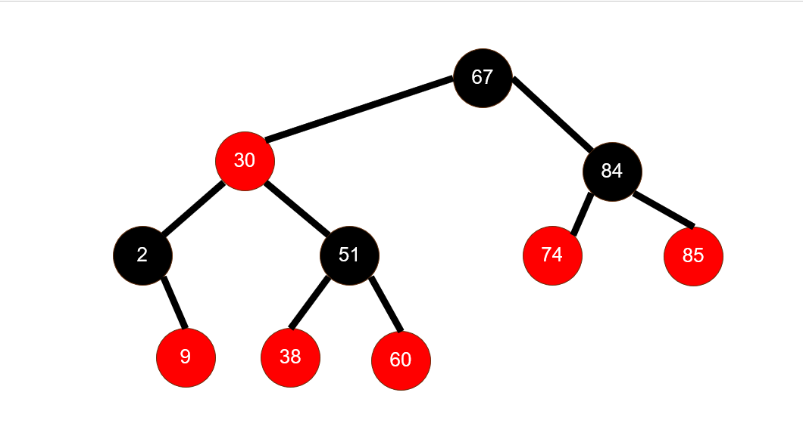

例如上图所示的红黑树，如果删除74、85，他们是右子节点的子节点，树不会退化；而如果删除9和2（此处不考虑平衡），左子节点的左子节点为null，再次删除元素时，就会导致该树退化为链表

#### 索引计算与容量

HashMap的索引计算实际上是两次哈希计算，然后再映射到桶数组中。首先调用键对象的hashCode()方法，再调用HashMap的hash()方法进行二次哈希，最后计算hash() & (capacity - 1)得到索引

```java
static final int hash(Object key) {
    int h;
    return (key == null) ? 0 : (h = key.hashCode()) ^ (h >>> 16);
}
```

hash()方法一般被称为二次哈希，计算方式是将原始Key无符号右移16位，然后异或原始Key。为什么需要二次哈希呢？因为桶数组的长度一定小于哈希值的长度，Java对象的hashcode特点是高位变化大，低位变化比较小甚至重复，因此如果直接用hashcode计算索引，只会将低位参与运算，很容易导致索引分布不均，提升大容量桶出现的可能。而将hashcode右移16位，就可以保证计算索引时使用的是hashcode的高位，而且hash()本身还能提供一次混淆，让分布更加随机

HashMap有个显著的特点，其桶数组长度一定为2的n次幂，从上文代码分析中我们知道，初始桶数组长度为16，每次扩容时扩容到原长度的2倍。当容量为2的n次幂时，计算索引就可以直接计算hash() & cap - 1，扩容时需要移动的元素位置也可以直接计算i + oldCap，这样可以提高HashMap的整体效率

但是选择2的n次幂并不全是好处，如果选择桶数组长度为2的n次幂，插入的元素如果都是偶数，会造成哈希分布不均，所有的值都会落在偶数位置的桶中。如果需要追求更好的哈希分布性，则应该选择数组长度为质数，数组长度为质数时，即使不使用二次哈希，也能保证哈希结果均匀

#### 并发问题

无论是jdk1.7还是jdk1.8，HashMap并发下都可能会出现数据错乱的问题，而且jdk1.7下的HashMap在扩容时还可能造成死链问题

##### 数据错乱

```java
if ((p = tab[i = (n - 1) & hash]) == null)
    tab[i] = newNode(hash, key, value, null);
```

这是putVal()方法中，当桶为空时的插入逻辑。在以往的业务开发学习中，例如库存扣减问题，我们知道如果判断与扣减不是原子性的，那么很容易造成库存超卖问题。同理，这里的桶为空判断与节点替换操作也不是原子性的，如果有多个线程同时put索引一致的元素，在任一线程执行成功tab[i] = newNode(hash, key, value, null)之前，所有的线程都会将if ((p = tab[i = (n - 1) & hash]) == null)判定为true，从而导致每个线程都会执行一次tab[i] = newNode(hash, key, value, null)，正常情况下能插入所有元素，但是在并发下，只有最后一个执行tab[i] = newNode(hash, key, value, null)的线程能保留自己的数据，其他线程的数据都会因为被覆盖而丢失

在线程安全的ConcurrentHashMap中，就将插入操作进行了原子化，多个线程同时插入，仅允许一个插入成功，失败的进行重试

```java
else if ((f = tabAt(tab, i = (n - 1) & hash)) == null) {
    if (casTabAt(tab, i, null, new Node<K,V>(hash, key, value)))
        break;                   // no lock when adding to empty bin
}
```

##### 死链

jdk1.7与1.8的扩容流程并不是相同的，上文中的实现也是基于jdk21的新实现方式。在jdk1.7中，数据插入使用了头插法，也就是将数据插入到链表头部，与1.8相反。1.7使用了两个指针变量来记录链表中的元素，e表示当前元素，next表示下一个元素，这与1.8相同。在一轮循环时，e指向头元素，next下移指向二号元素，然后移动头元素到新位置，e移动到二号元素，循环结束；二轮循环开始，next下移指向三号元素，暂定三号元素为null，然后将二号元素插入到一号元素的头部，e下移，二轮循环结束；三轮循环开始，e发现当前元素为null，因此退出循环，完成链表的迁移

而节点中也存在一个next指针，指向自己链表的下一个元素。HashMap的头插入，实际就是将待转移的节点的next，也就是e.next赋值为新数组的位置，当转移头节点时，e.next指向新数组的空位置，所以头结点就成了尾节点；转移其他节点时，将e.next赋值为新数组的位置，也就是新数据中头结点的地址，新转移的节点也就成了头结点

现在假设有一个链表，顺序为a->b->c，有两个线程同时触发扩容操作，线程1记录了e和next的位置，此时cpu线程切换，线程2执行，所以线程2也记录了e和next的位置，并移动了旧元素到新位置。此时又切换回到线程1，线程1由于已经记录了e和next，所以仍然可以访问原来链表上的数据，但是顺序是相反的，因为新链表是使用头插法插入的。线程1的e为a，next为b，但是此时链表变成了c->b->a，线程1取出a插入自己的桶，a.next此时为null，e更新为b；二轮，next为b.next，也就是a，然后取出b插入自己的桶，b.next仍为a，e更新为a；三轮，next为a.next，也就是null，然后取出a插入到自己的桶，a.next更新为b，e更新为null。循环退出，但是一个环形成了，a.next为b，b.next为a，虽然扩容本身没有问题，但是一旦查询该桶中不存在的元素时，指针就会在a和b之间无限循环，形成死链

#### Key规范

HashMap的Key允许为null，但是某些Map的实现类，如Hashtable、ConcurrentHashMap、TreeMap等不允许Key为null，否则可能出现空指针异常。在HashMap中，如果键为null，Entry则会被放置在0号桶中。如果需要作为Key对象，必须实现hashcode()方法和equals()方法，hashcode用于计算键的哈希值，equals()用于插入时判断是否是重复键

Key必须是一个不可变对象，如果将一个Key插入Map后，Key进行了变更，很可能导致哈希值改变，从而无法找到该Key

## 单例模式

单例模式是指整个程序中只允许存在一个实例，在任意时间调用任意实例，必须返回同一个实例。单例模式的特点是构造器必须私有化

### 饿汉式

饿汉式单例相对于懒汉式单例，是指在返回实例前就已经创建了实例。饿汉式单例利用static静态成员变量的特性，Java类中的静态成员变量所有实例共享一个，所以可以在单例类中定义一个静态成员变量，然后提供一个get方法获取这个变量

```java
import java.io.Serializable;

public class HungrySingleton implements Serializable {

    private HungrySingleton() {}

    private static final HungrySingleton INSTANCE = new HungrySingleton();

    public static HungrySingleton getInstance() {
        return INSTANCE;
    }
}
```

#### 单例破坏

饿汉式单例可以通过反射、反序列化、unsafe等手段破坏单例

##### 反射

利用反射获取构造器，强行设置为私有，然后调用构造器构造新实例

```java
public static void main(String[] args) throws Exception {
    HungrySingleton instance1 = HungrySingleton.getInstance();
    System.out.println(instance1);
    // 反射破坏
    Constructor<HungrySingleton> constructor = HungrySingleton.class.getDeclaredConstructor();
    constructor.setAccessible(true);
    HungrySingleton instance2 = constructor.newInstance();
    System.out.println(instance2);
}
```

> 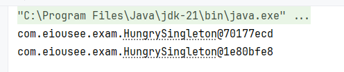

可以通过在构造器中添加判定来预防反射破坏

```java
public class HungrySingleton implements Serializable {

    private HungrySingleton() {
        if (INSTANCE != null)
            throw new RuntimeException("Instance already exists");
    }

    private static final HungrySingleton INSTANCE = new HungrySingleton();

    public static HungrySingleton getInstance() {
        return INSTANCE;
    }
}
```

> 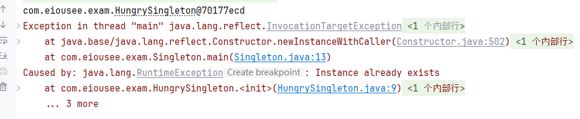

##### 反序列化

如果单例类实现了Serializable接口，在反序列化时构造对象不通过构造器，很容易破坏单例

```java
public static void main(String[] args) throws Exception {
    HungrySingleton instance1 = HungrySingleton.getInstance();
    System.out.println(instance1);
    // 反序列化破坏
    ByteArrayOutputStream baos = new ByteArrayOutputStream();
    ObjectOutputStream oos = new ObjectOutputStream(baos);
    oos.writeObject(instance1);
    ObjectInputStream ois = new ObjectInputStream(new ByteArrayInputStream(baos.toByteArray()));
    HungrySingleton instance2 = (HungrySingleton) ois.readObject();
    System.out.println(instance2);
}
```

> 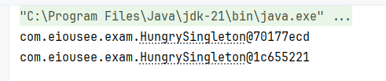

如果重写了readResolve()方法，反序列化时则会将该方法的返回值作为反序列化的结果

```java
public class HungrySingleton implements Serializable {

    private HungrySingleton() {
        if (INSTANCE != null)
            throw new RuntimeException("Instance already exists");
    }

    private static final HungrySingleton INSTANCE = new HungrySingleton();

    public static HungrySingleton getInstance() {
        return INSTANCE;
    }

    @Serial
    public Object readResolve() {
        return INSTANCE;
    }
}
```

> 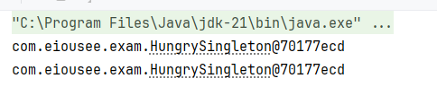

##### unsafe

unsafe全限定名sun.misc.Unsafe，是Java底层中直接操作内存、线程和对象布局的类，jdk自身大量使用了unsafe类，但是禁止任何第三方使用。unsafe可以直接绕过构造器创建对象，无视private，不进行初始化。而普通类调用Unsafe.getUnsafe()会直接抛出SecurityException安全异常，所以需要使用反射获取，而且jvm参数需要添加--illegal-access=permit。在jdk17.0之后，--illegal-access=permit参数被移除

```java
public static void main(String[] args) throws Exception {
    HungrySingleton instance1 = HungrySingleton.getInstance();
    System.out.println(instance1);
    // unsafe
    Unsafe unsafe = getUnsafe();
    HungrySingleton instance2 = (HungrySingleton) unsafe.allocateInstance(HungrySingleton.class);
    System.out.println(instance2);
}

public static Unsafe getUnsafe() throws Exception {
    Field f = Unsafe.class.getDeclaredField("theUnsafe");
    f.setAccessible(true);
    return (Unsafe) f.get(null);
}
```

> 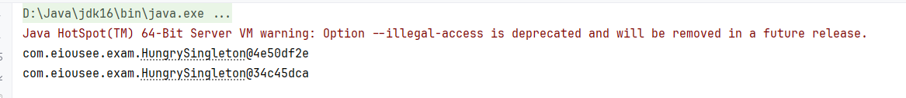

*注：Unsafe本身其实也是单例模式*

### 枚举饿汉式

Java中其实自带一个单例类Enum，Enum是枚举类，当Enum中枚举数量为1时，就可以认为是一个单例类，而且枚举类中允许定义方法

```java
import java.io.Serializable;

public enum EnumHungrySingleton implements Serializable {
    INSTANCE;

    public static EnumHungrySingleton getInstance() {
        return INSTANCE;
    }

    @Override
    public String toString() {
        return getClass().getName() + "@" + Integer.toHexString(hashCode());
    }
}
```

枚举饿汉式单例可以预防反射和反序列化破坏，但是无法预防unsafe

> 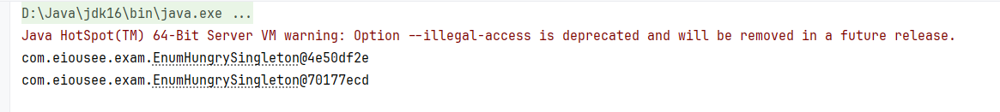

### 懒汉式单例

懒汉式单例就是在调用getInstance方法时才创建对象，如果已经存在，则返回该对象

```java
public class LazySingleton implements Serializable {

    private LazySingleton() {}

    private static LazySingleton INSTANCE = null;

    public static LazySingleton getInstance() {
        if (INSTANCE == null)
            INSTANCE = new LazySingleton();
        return INSTANCE;
    }
}
```

> 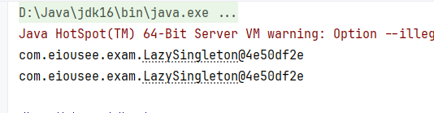

懒汉式单例在多线程下会出现问题，因为判断INSTANCE是否为null和创建新的INSTANCE并赋值不是原子操作，并发下，可能有多个线程满足INSTANCE == null，然后创建实例并赋值。虽然不会最终单例，但是仍存在一定问题。最简单的解决方法是添加互斥锁

```java
public static synchronized LazySingleton getInstance() {
    if (INSTANCE == null)
        INSTANCE = new LazySingleton();
    return INSTANCE;
}
```

### DCL懒汉式

如果对getInstance方法添加互斥锁，虽然可以解决并发安全问题，但是也会带来严重的性能影响。实例的创建仅在第一次调用时触发，但每个后续的线程都需要尝试获取这个锁，而且即使实例已经创建好了，不存在并发安全问题时仍需要获取锁。为了解决这个问题，就需要引入DCL

DCL全称Double Check Lock双检索，它的思想是锁住的范围不能是整个方法，而是获取锁的逻辑，在获取锁之前先判断一次是否需要获取锁，转换到单例模式上，也就是在获取锁之前先判断一次实例是否已经创建了，如果实例没有创建，才尝试获取获

```java
public class LazySingleton implements Serializable {

    private LazySingleton() {}

    private static LazySingleton INSTANCE = null;

    public static LazySingleton getInstance() {

        if (INSTANCE == null) {
            synchronized (LazySingleton.class) {
                if (INSTANCE == null)
                    INSTANCE = new LazySingleton();
            }
        }
        return INSTANCE;
    }
}
```

第一次的if决定是否应该获取锁，第二次的if才决定谁来创建这个实例。如果没有第二个if，在并发情况下，很可能多个线程同时满足第一个if，所以全部等待获取锁，当第一个线程创建实例完成后，因为没有第二次if，所以第二个线程也会创建一个实例，并覆盖之前的实例。因此，再一次使用if，就是为了保证实例只会被创建一次

如果使用双检索，还需要为INSTANCE添加一个volatile修饰符，确保其他线程不会获取到未初始化完成的实例

```java
private static volatile LazySingleton INSTANCE = null;
```

### 内部类懒汉式

为什么饿汉式单例不需要考虑线程安全问题？因为饿汉式单例的实例创建在静态成员变量中，静态成员变量的赋值由静态代码块负责，而静态代码块的线程安全问题由JVM虚拟机负责，因此，如果我们也在静态代码块中创建实例，就不需要考虑线程安全问题了

而静态成员中，静态内部类有一个特性，静态内部类只有在第一次调用时才会进行初始化。这正好符合懒汉式的定义，我们可以在单例类中定义一个静态内部类，在静态内部类中创建一个单例实例，然后由单例类提供getInstance方法即可

```java
import java.io.Serializable;

public class StaticInnerClassLazySingleton implements Serializable {

    private StaticInnerClassLazySingleton() {}

    private static class Provider {
        static final StaticInnerClassLazySingleton INSTANCE = new StaticInnerClassLazySingleton();
    }

    public static StaticInnerClassLazySingleton getInstance() {
        return Provider.INSTANCE;
    }
}
```

### 单例模式的使用案例

在jdk或者一些第三方库中，就是用了单例模式，如jdk的Runtime类

```java
public class Runtime {
    private static final Runtime currentRuntime = new Runtime();

    private static Version version;

    /**
     * Returns the runtime object associated with the current Java application.
     * Most of the methods of class {@code Runtime} are instance
     * methods and must be invoked with respect to the current runtime object.
     *
     * @return  the {@code Runtime} object associated with the current
     *          Java application.
     */
    public static Runtime getRuntime() {
        return currentRuntime;
    }

    /** Don't let anyone else instantiate this class */
    private Runtime() {}
}
```

可以看到Runtime的构造器为私有，提供了静态变量并进行了初始化，同时提供了getRuntime方法，是一个非常标准的饿汉式单例

以及System类中的Console内部类，实际是一种DCL懒汉式单例

```java
private static volatile Console cons;

/**
 * Returns the unique {@link java.io.Console Console} object associated
 * with the current Java virtual machine, if any.
 *
 * @return  The system console, if any, otherwise {@code null}.
 *
 * @since   1.6
 */
 public static Console console() {
     Console c;
     if ((c = cons) == null) {
         synchronized (System.class) {
             if ((c = cons) == null) {
                 cons = c = SharedSecrets.getJavaIOAccess().console();
             }
         }
     }
     return c;
 }
```

在Collections集合工具类中，大量的内部类都体现了单例模式

```java
private static class EmptyNavigableSet<E> extends UnmodifiableNavigableSet<E>
    implements Serializable {
    @java.io.Serial
    private static final long serialVersionUID = -6291252904449939134L;

    public EmptyNavigableSet() {
        super(new TreeSet<>());
    }

    @java.io.Serial
    private Object readResolve()        { return EMPTY_NAVIGABLE_SET; }
}

@SuppressWarnings("rawtypes")
private static final NavigableSet<?> EMPTY_NAVIGABLE_SET =
        new EmptyNavigableSet<>();
```

例如EmptyNavigableSet，内部类本身是private，所以构造器即使设置为public，其他类也不能调用，然后提供了静态成员变量存储唯一的实例。EmptyNavigableSet属于懒汉式单例，仅有在调用emptySortedSet()和emptyNavigableSet()两个方法时才会初始化内部类，并创建实例

> 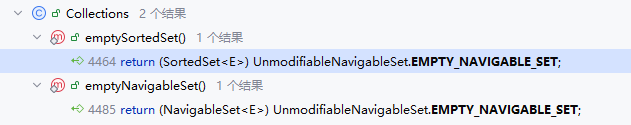

Comparator.Comparators中的NaturalOrderComparator类是一个枚举单例类

```java
enum NaturalOrderComparator implements Comparator<Comparable<Object>> {
    INSTANCE;

    @Override
    public int compare(Comparable<Object> c1, Comparable<Object> c2) {
        return c1.compareTo(c2);
    }

    @Override
    public Comparator<Comparable<Object>> reversed() {
        return Comparator.reverseOrder();
    }
}
```

## 并发

### 线程状态

不同于计算机操作系统，在Java中，一般将线程状态分为六类

- NEW 新建：当使用new关键字声明一个新的线程实例时，线程处于新建状态，此时线程还没有与cpu建立关联
- RUNNABLE 可运行：调用线程对象的start方法后，线程由新建状态转换为可运行状态，与cpu中的线程建立关联，并将人物代码交由cpu执行
- TERMINATED 终结：当代码执行完毕，没有后续人物，线程进入终结状态，线程的生命周期完成，底层的相关资源也会释放
- BLOCKED 阻塞：多个线程可能会尝试竞争锁，获取锁成功的线程进入可运行态，获取锁失败的线程则进入阻塞态，等待锁释放
- WAITING 等待：当锁竞争成功，但是某些任务的条件还不满足，无法继续执行，则需要执行wait()释放锁，并进入等待状态；当条件满足后，执行notify()唤醒等待的线程，但是线程需要重新竞争锁
- TIMED_WAITING 超时等待：如果执行wait()函数时传入了一个参数long，则会进入超时等待状态，long表示等待超时时间，单位毫秒；如果中途没有notify()唤醒，则超时时间到期后，会自动唤醒超时等待的线程。如果对可运行态的线程执行sleep(long)，也会让线程进入超时等待状态

计算机操作系统中，一般将线程状态划分为五类：新建、就绪、运行、终结、阻塞。其中新建、终结和运行态与Java类似，而就绪态是指可以分到cpu时间，但是目前没有分到cpu时间的状态；操作系统中的阻塞态是指无法分到cpu时间的，其中包含了阻塞IO、BLOCKED、WAITING、TIMED WAITING等

### 线程池核心参数

线程池核心参数一般是指Java中创建线程池时，其构造函数的核心参数的意义。线程池核心参数一般有7个

- corePoolSize：核心线程数，最多保留的线程数，线程池由核心线程和救急线程两部分组成，救急线程一般只会在核心线程不可用以及任务队列满时创建，并且救急线程会在使用后释放
- maximumPoolSize：最大线程数目，等于核心线程加上救急线程
- keepAliveTime：救急线程最大生存时间，到期后会释放救急线程
- unit：救急线程生存时间单位
- workQueue：阻塞队列，也就是工作等待队列，当向线程池提交任务时，如果核心线程都在忙，则会进入阻塞队列，当阻塞队列满，才会创建救急线程
- threadFactory：线程工厂，可以让开发者自定义如何创建线程，但是一般仅为线程命名
- handler：拒绝策略，一般有四种。AbortPolicy，线程池已关闭，或队列已满且线程数已达maximumPoolSize时直接抛出RejectedExecutionException；CallerRunsPolicy，由由提交任务的线程自己执行该任务；DiscardPolicy，直接丢弃任务，不做任何处理；DiscardOldestPolicy，丢弃队列中最旧的任务，然后重新提交当前任务

```java
public static void main(String[] args) throws Exception {
    AtomicInteger i = new AtomicInteger(1);
    BlockingQueue<Runnable> queue = new ArrayBlockingQueue<>(2);
    ThreadPoolExecutor threadPoolExecutor = new ThreadPoolExecutor(
            2,
            3,
            0,
            TimeUnit.SECONDS,
            queue,
            r -> new Thread(r, "TestThread" + i.getAndIncrement()),
            new ThreadPoolExecutor.CallerRunsPolicy()
    );
}
```

这是创建线程池的一个示例，当前线程池核心线程数量为2，最大线程数为3，救急线程生存时间0秒，等待队列长度为2，线程池工厂中为每个线程命名为`TestThread + 自增编号`，拒绝策略设置为了调用者执行策略

*注：救急线程也会取出等待队列中的任务执行，只有当任务队列为空时，才会开始计算救急线程的生存时间*

### Sleep() vs Wait()

共同点：wait()、wait(long)和sleep(long)的效果都是让当前线程暂时放弃cpu使用权，进入阻塞状态。但是两个方法的归属不同，sleep(long)是Thread线程类的静态方法，可以理解为线程执行的任务调度；而wait()和wait(long)都属于Object对象成员方法，每个对象都有，所以wait()是任务对象主动申请等待，线程被迫等待

sleep(long)和wait(long)的线程都会在等待相应毫秒后醒来，wait(long)和wait()还可以被notify()唤醒，wait()如果不唤醒则会一直保持等待。同时它们均可被打断唤醒

wait()的调用必须先获取wait()对象的锁，而sleep()没有这个限制。wait()方法执行后会释放对象锁，允许其他线程获取该对象锁；而sleep()如果在synchronized代码块中执行，不会释放对象锁，其他线程仍需要等待锁释放

### Lock vs Synchronized

语法层面，synchronized是关键字，源码在jvm中，使用C++语言实现；而Lock是接口，源码由jdk提供，使用Java实现。使用synchronized时，退出同步代码块锁会自动释放，但使用Lock时，需要手动调用unlock方法释放锁

功能层面，二者均属于悲观锁，都具备基本的互斥、同步、锁重入功能。Lock提供了许多synchronized不具备的功能，如获取等到状态、公平锁、可打断、可超时、多条件变量等等；Lock有适合不同场景的不同实现，如ReentrantLock、ReentrantReadWriteLock等

性能层面，在没有竞争时，synchronized做了很多性能优化，如偏向锁，轻量级锁；而在竞争激烈时，Lock的实现通常会提供更好的性能

### Volatile

volatile如何保证线程安全性？线程安全要考虑三个方面：

- 原子性：一个线程内多行代码以一个整体运行，期间不能有其他线程的代码插队

- 可见性：一个线程对共享变量修改，另一个线程能看到最新结果
- 有序性：一个线程内代码按编写顺序执行，不能因为cpu优化将代码顺序改变

volatile能保证共享变量的可见性与有序性，但是无法保证其原子性

#### 原子性

```java
import java.util.concurrent.CountDownLatch;

public class Test {

    private static final int TIMES = 100000;
    public static volatile int balance = TIMES;

    public static void sub() {
        balance -= 1;
    }

    public static void main(String[] args) throws InterruptedException {
        CountDownLatch latch = new CountDownLatch(TIMES);
        for (int i = 0; i < TIMES; i++) {
            new Thread(() -> {
                sub();
                latch.countDown();
            }).start();
        }
        latch.await();
        System.out.println("当前TIMES：" + TIMES);
        System.out.println("balance结果：" +balance);
    }
}
```

在Test类中，我们声明了一个常量TIMES，设置为10万，然后将TIMES赋值给了balance，balance是静态成员变量，拥有volatile关键字，同时定义了一份sub方法，每次调用让balance减一。然后在主方法中，定义了一个CountDownLatch实例，CountDownLatch用于多线程下的线程同步，如果在初始化CountDownLatch时传入一个int类型的参数，执行latch.await()的线程就必须等待CountDownLatch的计数器为0时才能继续执行。所以这里传入CountDownLatch的值也为TIMES，然后定义一个循环创建TIMES个数的线程，每个线程执行一次sub方法，理想情况下，最后的balance应该为0。我们先用比较小的数字进行尝试

> 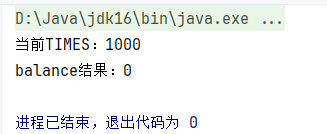

在jvm虚拟机中，对静态成员变量的增减操作实际并不是只有一条命令，我们反编译class文件

```java
 public static void sub();
    descriptor: ()V
    flags: (0x0009) ACC_PUBLIC, ACC_STATIC
    Code:
      stack=2, locals=0, args_size=0
         0: getstatic     #7                  // Field balance:I
         3: iconst_1
         4: isub
         5: putstatic     #7                  // Field balance:I
         8: return
      LineNumberTable:
        line 11: 0
        line 12: 8

```

在字节码文件中，sub 方法由四个命令组成，getstatic获取静态成员变量，iconst_1定义字面量1，isub执行减法，putstatic将计算结果复制给静态成员变量。所以其实在jvm中，sub在进行计算时使用的数字是静态成员变量的副本，即使静态成员变量在getstatic之后发生了变更，sub方法中仍会按照原来的值进行计算，而putstatic导致错误的值赋值到变量中。如果我们将TIMES的值调大一些，就会发现最后balance并不为0

> 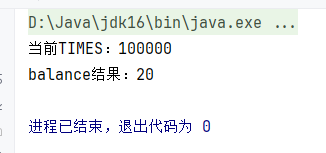

而且idea也会提醒我们非原子操作

> 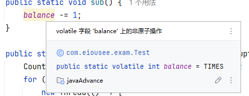

#### 可见性

```java
public class Test {

    public static boolean stop = false;

    public static void main(String[] args) throws InterruptedException {
        new Thread(Test::run).start();
        Thread.sleep(1000);
        stop = true;
        System.out.println("stop is true now!");
    }

    public static void run() {
        int i = 0;
        while (!stop)
            i++;
        System.out.println("Stopped!, i = " + i);
    }
}
```

观察如上代码，我们定义了一个成员变量stop，表示循环是否应该停止。又定义了一个方法run，run中定义i记录循环次数，然后开始死循环，最后输出循环次数。然后在主方法中定义一个单独的线程执行run方法，并设置1000毫秒的等待时间，到期后设置stop为true，查看1000ms时间内循环的次数

> 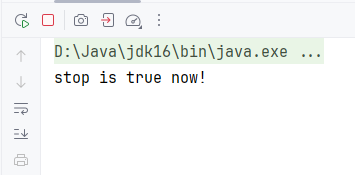

但实际的结果却很意外，在启动主方法后，程序进入了死循环，即使已经输出了stop is true now!，子线程仍没有停止。这正是因为stop成员变量缺乏可见性，当主线程更新stop的值后，子线程并没有更新自己的stop的值，所以一直认为stop为false，导致循环无法退出。而使用volatile就可以保证成员变量的可见性

```java
public static volatile boolean stop = false;
```

> 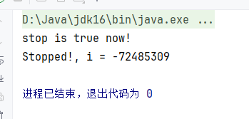

##### 根本原因

~~可见性问题的根本原因是，在不同线程的情况下，会由不同的cpu执行代码，cpu在获取静态成员变量时，会从内存中将该变量的值复制到自己的高速缓存中，如果cpu0修改了某个变量的值，但是该值只存在于cpu0的高速缓存中，并没有同步给其他cpu缓存，因此其他cpu只能按照旧值进行运算~~

以上是某些错误的说法，我们可以用示例来证明。如果cpu0只修改了自己的值，那么再定义一个线程去读取stop，查看stop究竟是true还是false。注意需要去掉stop的volatile修饰符

```java
public static void main(String[] args) throws InterruptedException {
    new Thread(Test::run).start();
    Thread.sleep(1000);
    stop = true;
    Thread.sleep(100);
    new Thread(() -> {
        System.out.println(stop);
    }).start();
    System.out.println("stop is true now!");
}
```

> 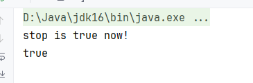

很显然，第二个线程读取到的stop为true，那有没有可能是因为主线程的问题呢？我们不在主线程中更新stop，而是在子线程中更新stop，然后由主线程读取

```java
public static void main(String[] args) throws InterruptedException {
    new Thread(Test::run).start();
    Thread.sleep(1000);
    new Thread(() -> stop = true).start();
    Thread.sleep(100);
    System.out.println("stop is true now!");
    System.out.println(stop);
}
```

> 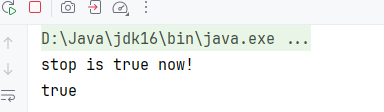

结果仍是true，所以一开始的那种说法是完全错误的。可见性问题的真正来源，是JIT，JIT全称Java In Time Complier即时编译器，是JVM中核心的性能优化组件，JIT会分析字节码中的内容，然后进行进一步的优化，就比如这里的大循环。而JIT的优化，实际是直接将原有的字节码替换为优化后的机器码，如果中间变量被修改，cpu在执行时仍会按照JIT优化后的机器码执行，导致变量没有正确更新

我们可以用多个案例来证明，如果真的是因为JIT优化，那么我们可以减少循环次数，也就是减少等待时间。目前CPU运算速度都非常快，经过实际的测试，即使设置Thread.sleep(1)也会触发JIT优化，因此这里利用System.nanoTime()，设置end = System.nanoTime() + 500_000，然后while (System.nanoTime() < end)进行空转，这样可以略微实现500微秒的延迟

```java
public static boolean stop = false;

public static void main(String[] args) throws InterruptedException {
    new Thread(Test::run).start();
    long end = System.nanoTime() + 500_000; // 500μs
    while (System.nanoTime() < end) {
        // 空转
    }
    stop = true;
    System.out.println("stop is true now!");
}
```

> 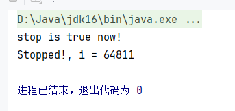

可以看到，即使没有使用volatile修饰，循环也正确停止了，总计循环64811次

或者我们也可以关闭JIT优化，在jvm参数中添加-Xint，即使延迟1000ms也能正确停止

> 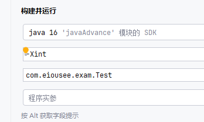

> 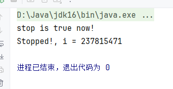

可以看到最终循环了237815471次，一般循环次数约等于CPU频率，我的cpu频率为4GHz左右，而循环次数仅为cpu频率的一半，也能看到cpu性能确实因为缺少JIT优化而降低

> 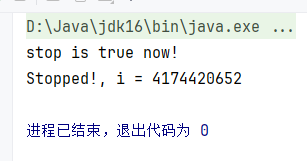

#### 有序性

```java
import org.openjdk.jcstress.annotations.*;
import org.openjdk.jcstress.infra.results.II_Result;

@JCStressTest
@Outcome(id = {"0, 0", "0, 1", "1, 1"}, expect = Expect.ACCEPTABLE, desc = "ACCEPTABLE")
@Outcome(id = {"1, 0"}, expect = Expect.ACCEPTABLE_INTERESTING, desc = "INTERESTING")
@State
public class Test {

    int x;
    int y;

    @Actor
    public void set() {
        x = 1;
        y = 1;
    }

    @Actor
    public void get(II_Result result) {
        result.r1 = y;
        result.r2 = x;
    }
}
```

使用jcstress编写一个并发测试类，定义两个属性x和y，然后定义两个方法set和get，让两个线程分别执行set和get，可能会出现以下几种结果

- 1, 1：正常结果，set方法比get方法先执行
- 0, 0：正常结果，get方法比set方法先执行
- 0, 1：正常结果，如果x = 1先执行，然后执行了get方法，再执行y = 1；或者result.r1 = y先执行，然后执行了set方法，再执行result.r2 = x
- 1, 0：异常结果，如果不考虑cpu指令顺序变更，不可能出现这种情况

> 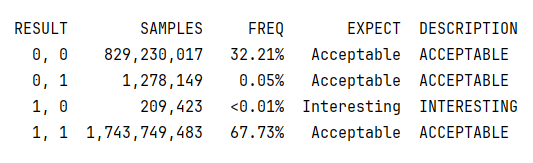

结果中有大约0.01%的结果是1,0，所以cpu指令重排序的现象是真实存在的，并且会对并发安全造成很大的威胁。因此需要使用volatile阻止指令重排序，而这里volatile添加的位置也需要注意，应当添加在y属性上，而不是x属性。volatile的工作原理是增加内存屏障，对于写操作，屏障方向向上，volatile指令上方的其他指令无法穿越屏障到volatile指令之后；对于读操作，屏障方向向下

如果在x上添加volatile修饰符，x之前的写操作不能重排在x后方，但是本来y的写操作就在x后方，所以仍会导致重排；同理，x之后的读操作不能排在x前方，但是y的读操作本来就在x前方，不受volatile影响

> 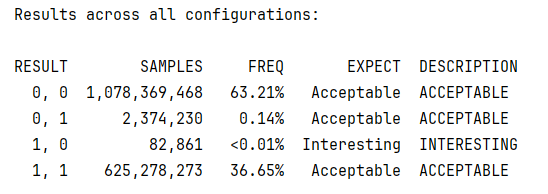

1,0的情况仍然存在，所以我们再将volatile添加在y上

> 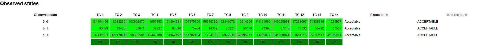

由于没有interest结果集，终端并没有返回结果，所以在报告页中查看。可以确定在所有测试结果中，1,0不存在，volatile可以保证命令的有序性

*注：由于内存屏障的单向性，对于volatile属性的写操作，必须在其他属性之后；对于volatile属性的读操作，必须在其他属性之前，否则volatile无效*

### 悲观锁与乐观锁

#### 概念

悲观锁的代表是synchronized和Lock锁，其核心思想是线程只有获取了锁，才有资格去操作共享变量，每次只能有一个线程获取锁成功，获取锁失败的线程都必须等待锁释放。悲观锁线程从运行到阻塞，再从阻塞到唤醒，涉及线程上下文切换，如果频繁发生，则会严重影响性能。不过在Java中，线程在获取synchronized和Lock锁时，如果锁被占用，则会进行几次重试操作，重试失败后才会进入阻塞，减少阻塞机会

乐观锁的代表是AtomicInteger，使用CAS来保证原子性。乐观锁核心思想是不加锁，每次仅有一个线程能够成功修改共享变量，其他失败的线程不需要阻塞等待，而是一直重试直到成功。由于线程一直运行，不需要阻塞，不涉及线程上下文切换，并发性能比悲观锁好得多。但乐观锁需要多核cpu支持，且线程数不超过cpu核心数

*注：现代处理器支持超线程功能，即将一个物理核心划分为多个逻辑核心，对于进程而言一个逻辑核心等于一个cpu*

#### CAS

CAS，全称Compare And Swap，是一种乐观锁思想的原子更新机制，核心逻辑就是在更新数据之前，先判断数据是否被修改，只有当数据没有被修改才进行更新。最常见的场景是秒杀库存场景，假设商品库存仅有100，但是有200个消费者抢购商品

```java
import java.util.concurrent.CountDownLatch;
import java.util.concurrent.ExecutorService;
import java.util.concurrent.Executors;

public class Seckill {

    public static volatile int stock = 100;

    public static void main(String[] args) throws InterruptedException {
        int threadCount = 10;
        int consumers = 200;
        ExecutorService executor = Executors.newFixedThreadPool(threadCount);
        CountDownLatch countDownLatch = new CountDownLatch(consumers);

        for (int i = 0; i < consumers; i++) {
            executor.submit(() -> {
                stock--;
                countDownLatch.countDown();
            });
        }
        countDownLatch.await();
        executor.shutdown();
        System.out.println(stock);
    }
}
```

> 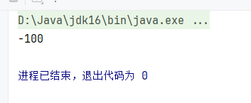

结果显而易见，如果不使用任何锁，一定会出现超卖问题。所以改用AtomicInteger保存stock，并使用updateAndGet原子性比较并赋值

```java
import java.util.concurrent.CountDownLatch;
import java.util.concurrent.ExecutorService;
import java.util.concurrent.Executors;
import java.util.concurrent.atomic.AtomicInteger;

public class Seckill {

    public static AtomicInteger stock = new AtomicInteger(100);

    public static void main(String[] args) throws InterruptedException {
        int threadCount = 10;
        int consumers = 200;
        ExecutorService executor = Executors.newFixedThreadPool(threadCount);
        CountDownLatch countDownLatch = new CountDownLatch(consumers);

        for (int i = 0; i < consumers; i++) {
            executor.submit(() -> {
                stock.updateAndGet(stock -> stock > 0 ? stock - 1 : stock);
                countDownLatch.countDown();
            });
        }
        countDownLatch.await();
        executor.shutdown();
        System.out.println(stock);
    }
}
```

如果使用AtomicInteger，就可以不用再添加volatile关键字，AtomicInteger的updateAndGet传入的参数是一个java.util.function.IntUnaryOperator，也就是一个方法，该方法会原子性执行，返回值就是AtomicInteger的新值

```java
public final int updateAndGet(IntUnaryOperator updateFunction) {
    int prev = get(), next = 0;
    for (boolean haveNext = false;;) {
        if (!haveNext)
            next = updateFunction.applyAsInt(prev);
        if (weakCompareAndSetVolatile(prev, next))
            return next;
        haveNext = (prev == (prev = get()));
    }
}
```

其底层调用了unsafe的weakCompareAndSetInt方法，这就是一个CAS方法

### Hashtable vs ConcurrentHashMap

Hashtable是从jdk1.0版本就存在的数据类型，是最早期的键值对数据结构，底层使用的数据结构与HashMap类似，即数组结合链表。Hashtable继承自Dictionary类，这是Java初期的键值集合类，而且Dictionary的源码仍是抽象类，因为接口类从1.1才引入。Hashtable的迭代器并不是Iterator，而是Enumerator枚举器，Enumerator的性能比Iterator低，所以现代的代码中几乎没有再使用Enumerator

ConcurrentHashMap自1.5版本引入Java，在1.8版本经历了代码重塑，提升了ConcurrentHashMap的并发性能

Hashtable和ConcurrentHashMap都是线程安全的Map集合，Hashtable并发性能低，synchronized是方法级别，锁的范围是整个实例，对于同一个实例，同一时刻仅能有一个线程去进行操作。在1.8之前，ConcurrentHashMap使用了Segment + 数组 + 链表结构，每个Segment一把锁，如果多个线程访问不同的Segment，则不会冲突；在1.8之后，ConcurrentHashMap与HashMap使用相同的数据结构，数组的每个头结点作为锁，如果多个线程访问不同的桶，则不会冲突，大大提高了并发性能

#### Hashtable

在1.2引入Map集合之后，Hashtable也实现了Map类，用于表示Hashtable的归属，在1.5引入泛型后，Hashtable也支持了泛型

```java
public synchronized V put(K key, V value) {
    // Make sure the value is not null
    if (value == null) {
        throw new NullPointerException();
    }

    // Makes sure the key is not already in the hashtable.
    Entry<?,?> tab[] = table;
    int hash = key.hashCode();
    int index = (hash & 0x7FFFFFFF) % tab.length;
    @SuppressWarnings("unchecked")
    Entry<K,V> entry = (Entry<K,V>)tab[index];
    for(; entry != null ; entry = entry.next) {
        if ((entry.hash == hash) && entry.key.equals(key)) {
            V old = entry.value;
            entry.value = value;
            return old;
        }
    }

    addEntry(hash, key, value, index);
    return null;
}
```
